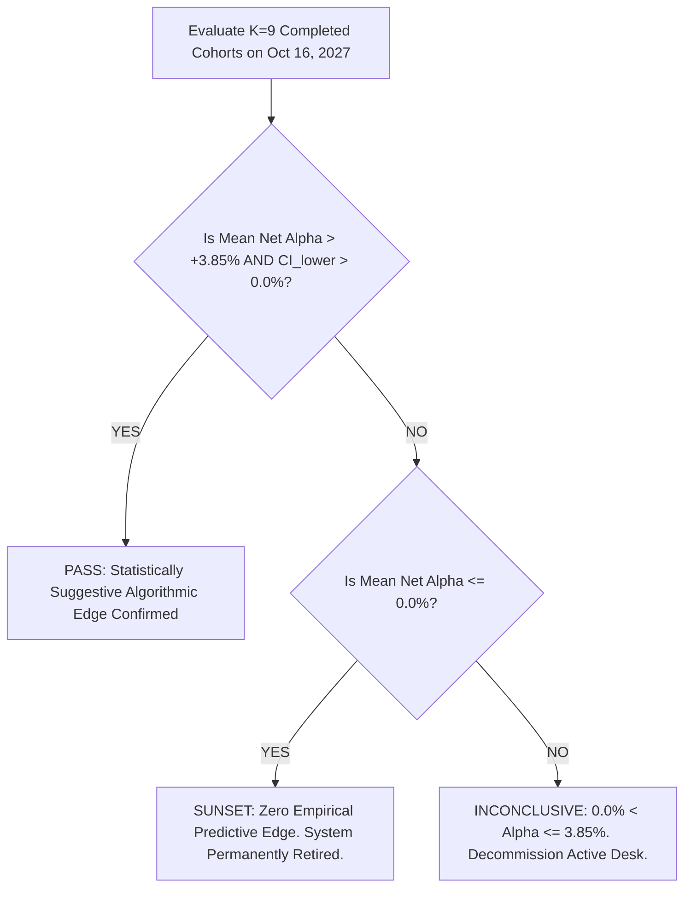

# 🏛️ TradeMatrix Forward Validation Protocol v2.1 (Final Pre-Registered Specification)

**Registration Date:** 16 October 2026, Friday  
**Document Status:** Final Pre-Registered Protocol v2.1  
**Reconciliation Reference:** [docs/one_page_research_summary.md](file:///c:/project/Trade_matrix/docs/one_page_research_summary.md)  
**Governance:** Institutional Empirical Research Protocol | Zero Advisory Tone | Educational Sandbox  

---

## 1. Executive Summary & Core Upgrades

This document resolves the **8 critical methodological requirements** identified in peer review. It establishes a rigorous, mathematically sound, dual-ledger forward testing architecture designed to test whether the Aladdin quantitative scoring engine produces genuine predictive alpha or random market noise.

```
+---------------------------------------------------------------------------------------------------------+
|                              FORWARD VALIDATION PROTOCOL v2.1 OVERVIEW                                  |
+---------------------------------------------------------------------------------------------------------+
| 1. DUAL-LEDGER SEPARATION   --> Ledger A: Primary Shadow (Fixed 90-Day, Fractional %/rupee, Zero SL/TP) |
|                             --> Ledger B: Secondary Live (₹25k Slots, Dynamic ATR Stop, 12% Target)    |
| 2. UNIFIED PRIMARY METRIC   --> Tool 10 Net Return minus Mean of 1,000 Random Baskets (Cohort Level)   |
| 3. COHORT TIMELINE (K=9)    --> Monthly Schedule (1st Trading Day); Mid-July 2027 Freeze Cap = 9 Cohorts|
| 4. PILOT RUN ISOLATION      --> 16 Oct 2026 = Cohort 0 (Pilot); Cohort 1 starts 03 Nov 2026 (Automated) |
| 5. BETWEEN-COHORT INFERENCE --> Cross-cohort standard error (SE = s / sqrt(K)); No pooled pseudo-sample|
| 6. HONEST POWER ESTIMATE    --> Min Detectable Edge ~3.3%/90d (~13.7% p.a.); Inconclusive is Baseline   |
| 7. STATUTORY FRICTION       --> Real Equity Delivery Schedule: ~0.38% on ₹25k (Zero Brokerage Delivery) |
| 8. REPRODUCIBILITY ENGINE   --> Scoring Git Hash locked; Corporate Actions/Dividend Adjusted Prices     |
+---------------------------------------------------------------------------------------------------------+
```

---

## 2. The 8 Critical Upgrades (Detailed Operational Specifications)

### Upgrade 1: Schedule, Capital Harmony & Cohort Timeline
* **Schedule Reconciliation:**
  - The schedule is strictly **Monthly** (executed automatically on the 1st trading day of each calendar month at 09:30 AM IST).
  - Bi-weekly runs are eliminated because overlapping 90-day holds would create 6–7 concurrent cohorts (~₹16L capital demand), breaching the ₹10,00,000 ceiling.
  - On a monthly schedule with a 90-day holding horizon, there are **at most 3 concurrent active live cohorts** (3 cohorts × ₹2,50,000 = ₹7,50,000), leaving a comfortable ₹2,50,000 cash buffer.
* **12-Month Calendar Deadline (16 October 2027) & Completed Cohort Count ($K=9$):**
  - To be evaluated on a complete 90-day holding basis before the hard deadline, a cohort must freeze on or before **mid-July 2027**.
  - Any cohort initiated in August, September, or October 2027 would remain uncompleted at the deadline.
  - Therefore, the protocol will evaluate exactly **$K = 9$ fully completed monthly cohorts** (November 2026 through July 2027).
* **Pilot Cohort 0 Designation:**
  - Today’s freeze (16 October 2026) is a mid-month manual run.
  - It is formally designated as **Cohort 0 (Pilot Verification Run)** and is **strictly quarantined from primary statistical inference**.
  - **Cohort 1 (Primary Series)** initiates automatically on the 1st trading day of November 2026 (03 November 2026).

---

### Upgrade 2: Dual-Ledger Architecture (Shadow vs Live Execution)
To prevent conflation between a pure selection test and tactical exit parameters:

```
+------------------------------------------------------------------------------------------------------+
| LEDGER A: PRIMARY SHADOW RESEARCH LEDGER       | LEDGER B: SECONDARY LIVE PAPER TRADING DESK         |
+------------------------------------------------+-----------------------------------------------------+
| • Purpose: Pure Stock Selection Validation     | • Purpose: Operational Execution & Tool Feasibility |
| • Horizon: Fixed 90 Calendar Days (Strict)     | • Horizon: Dynamic (Exits on Target/SL/RSI/90d)     |
| • Sizing: Fractional %-per-rupee (Exact 10.0%) | • Sizing: Integer Shares (~₹25,000 per slot)        |
| • Exits: Zero Stop Loss or Target Truncation   | • Exits: 12% Target, 2x ATR Dynamic SL, RSI > 70    |
| • Pricing: Corporate-Action Dividend-Adjusted  | • Pricing: Real-time Live Market Ticks (Fyers API)  |
| • Primary Statistical Decision Rule Applied    | • Auxiliary Diagnostic & Execution Cost Audit       |
+------------------------------------------------------------------------------------------------------+
```

---

### Upgrade 3: Single Unified Primary Metric
To eliminate multi-hypothesis testing ($p$-hacking) and structural weighting discrepancies:
* **Why Nifty 50 TRI is Secondary:** Nifty 50 is market-cap weighted (top 5 stocks represent >40% of index variance), whereas the Tool basket is equal-weighted. An equal-weight basket naturally has higher small/mid-beta than Nifty 50.
* **The Unified Primary Metric ($\Delta_{\text{Cohort}}$):**
  For each completed cohort $k \in \{1, \dots, 9\}$:
  $$\Delta_k = R_{\text{Tool Top 10, Net, } k} - \overline{R}_{\text{1000 Random Baskets, Net, } k}$$
  Where:
  - $R_{\text{Tool Top 10, Net, } k}$ is the equal-weighted 90-day net return of the 10 highest-ranked stocks in Cohort $k$.
  - $\overline{R}_{\text{1000 Random Baskets, Net, } k}$ is the mean 90-day net return of 1,000 pseudo-random 10-stock baskets drawn uniformly from the identical eligible universe on the exact same freeze date.
* **Hypothesis Test Across Cohorts ($K=9$):**
  $$\overline{\Delta} = \frac{1}{K} \sum_{k=1}^K \Delta_k, \quad s_{\Delta} = \sqrt{\frac{\sum (\Delta_k - \overline{\Delta})^2}{K - 1}}, \quad SE(\overline{\Delta}) = \frac{s_{\Delta}}{\sqrt{K}}$$
  $$\text{95% Confidence Interval} = \left[\overline{\Delta} - t_{0.025, K-1} \times SE(\overline{\Delta}), \quad \overline{\Delta} + t_{0.025, K-1} \times SE(\overline{\Delta})\right]$$
* **Secondary / Diagnostic Metrics (Logged but Not Primary Gates):**
  1. Full-Universe Spearman Rank Correlation ($\rho$).
  2. Empirical Monte Carlo Percentile ($p$-value among 1,000 random baskets).
  3. Excess Return over Nifty 50 TRI.
  4. Secondary Live Ledger (Ledger B) Tactical Strategy P&L.

---

### Upgrade 4: Between-Cohort Spearman Rank Correlation
* **Addressing Multi-Collinearity:** The 100 constituents within a single cohort share macroeconomic drift, industry shocks, and market beta. Running a pooled $t$-test assuming $N=100$ independent samples yields severely inflated degrees of freedom and spurious statistical significance.
* **Between-Cohort Evaluation:**
  - For each cohort $k$, calculate Spearman's rank correlation $\rho_k$ between Aladdin Composite Score at $T=0$ and the forward 90-day return across all eligible universe stocks.
  - The master correlation estimate is the **cross-cohort mean**:
    $$\overline{\rho} = \frac{1}{K} \sum_{k=1}^K \rho_k, \quad SE(\overline{\rho}) = \frac{s_{\rho}}{\sqrt{K}}$$
  - **Robustness Non-Overlapping Subsample:** In addition to the 9 overlapping monthly cohorts, evaluate the 3 strictly non-overlapping cohorts (**Cohort 1 [Nov], Cohort 4 [Feb], Cohort 7 [May]**) as an independent validation check.

---

### Upgrade 5: Power Analysis, Detectable Edge & Sunset Rule
* **Formal Power Estimation:**
  - Based on empirical Indian equity volatility, cohort excess return standard deviation is estimated at $\sigma_{\Delta} \approx 5.0\%$.
  - For $K = 9$ completed cohorts, the standard error is:
    $$SE(\overline{\Delta}) \approx \frac{5.0\%}{\sqrt{9}} = 1.67\%$$
  - With $t_{0.025, 8} = 2.306$, clearing the pre-registered pass rule ($\text{CI}_{\text{lower}} > 0.0\%$) requires:
    $$\overline{\Delta} > 2.306 \times 1.67\% = \mathbf{+3.85\% \text{ per 90-day cohort (}\approx +16.2\% \text{ annualized)}}$$
* **Honest Pre-Commitment:**
  - A small real edge (e.g. +1.0% to +2.0% per 90 days) will likely result in an **INCONCLUSIVE** classification due to sample size constraints.
  - **"INCONCLUSIVE" is the statistically most expected and intellectually honest baseline outcome.**
* **Sunset Rule Prerequisite ($K \ge 9$ Protection):**
  - The sunset decommissioning rule ($\overline{\Delta} \le 0.0\% \implies$ permanent shutdown) will **ONLY be applied after all $K \ge 9$ cohorts have completed their 90-day holding period**.
  - Decommissioning the system after 2 or 3 noisy early cohorts is strictly prohibited.

---

### Upgrade 6: Fractional Sizing & Strict Universe Consistency
* **Elimination of Price Cap Bias:** Skipping stocks $> ₹20,000$ (e.g. MRF, Page Industries) creates an arbitrary universe bias.
* **Implementation:**
  - **Primary Shadow Ledger (Ledger A):** Returns are computed on a **% per rupee basis (fractional shares)**. Exactly 10.0% of nominal cohort capital is allocated to each stock. Zero share price exclusion.
  - **Secondary Live Ledger (Ledger B):** Integer shares only. If share price exceeds ₹25,000, 1 share is assigned with capital rebalancing, or logged as an execution friction caveat.
* **Identical Universe Eligibility Filter:**
  The exact same liquidity filter applies identically to:
  1. `TOOL_TOP10`
  2. The 1,000 Random Baskets pool (drawn from all eligible stocks, including tool picks)
  3. Full-universe Spearman ranking
  - **Filter Criteria:** Active constituent of **Nifty 100** on freeze date $T=0$ with 30-day median daily turnover $\ge ₹10 \text{ Cr}$.

---

### Upgrade 7: Realistic Indian Delivery Statutory Friction Schedule
* **Broker Schedule Freeze (Zero Delivery Brokerage Standard):**
  On discount brokers (e.g. Zerodha, Fyers delivery accounts), equity delivery brokerage is ₹0.
* **Exact Cost Breakdown per Round-Trip Trade (Nominal ₹25,000):**
  1. **Brokerage:** ₹0.00 (Zero delivery fee).
  2. **STT (Securities Transaction Tax):** $0.10\%$ buy + $0.10\%$ sell = $0.20\%$.
  3. **Stamp Duty (State):** $0.015\%$ on buy turnover.
  4. **Exchange Turnover Fee (NSE):** $0.00297\%$ buy + $0.00297\%$ sell = $0.00594\%$.
  5. **SEBI Turnover Charges:** $0.0001\%$ round-trip.
  6. **GST (18% on Turnover & SEBI fees):** $0.18 \times 0.006\% \approx 0.0011\%$.
  7. **Depository DP Charges (CDSL/NSDL):** ₹15.93 per scrip on sell ($\frac{15.93}{25000} \approx 0.0637\%$).
  8. **Bid-Ask Spread & Market Impact Slippage:** $0.05\%$ entry + $0.05\%$ exit = $0.10\%$.
  $$\mathbf{\text{Total Frozen Statutory Friction}} = \mathbf{0.385\% \text{ (Locked in code as 0.385%)}}$$

---

### Upgrade 8: Reproducibility, Corporate Actions & Edge Cases
* **Code Version Lock:** Every freeze writes:
  - `scoring_git_hash`: Git SHA of the scoring codebase (e.g. `40404d2`).
  - `scoring_formula_version`: `ALADDIN_V2_5PILLAR`.
  - Modification of scoring logic automatically bifurcates the study into a new named series.
* **Corporate Actions & Dividends:**
  - Individual stock prices are sourced from **corporate-action dividend-adjusted archives** to match Nifty 50 TRI.
* **Deterministic Random Seed:**
  - The random seed for the 1,000 Monte Carlo control baskets is strictly deterministic:
    $$\text{Seed} = \text{int}(YYYYMMDD)$$
  - Any external auditor can 100% replicate all 1,000 baskets offline.
* **Suspension, Insolvency & Circuit-Lock Handling:**
  - **Insolvency / Delisting:** If a stock enters insolvency/delisting during the 90-day window, forward return is booked as **$-100.0\%$**.
  - **Trading Suspension:** Last recorded traded price is carried forward to Day 90.
  - **Circuit Lock on Day 90:** If locked on Day 90, exit price is evaluated at the first unconstrained open market session following Day 90.

---

## 3. Pre-Registered Decision Hurdle (Tri-State Protocol)

Evaluated strictly after the completion of all **$K = 9$ monthly cohorts** (October 16, 2027):



1. **Pass Condition (Validation):**
   - Cross-cohort mean excess return $\overline{\Delta} > +3.85\%$ per 90 days ($\approx +16.2\%$ annualized).
   - The 95% Confidence Interval lower bound must be strictly positive ($\text{CI}_{\text{lower}} > 0.0\%$).
2. **Inconclusive Condition ($0.0\% < \overline{\Delta} \le +3.85\%$ or $\text{CI}_{\text{lower}} \le 0.0\%$):**
   - The data is insufficient to reject the null hypothesis of luck/noise. The active descriptive desk is decommissioned without marketing claims.
3. **Sunset Condition ($\overline{\Delta} \le 0.0\%$):**
   - Aladdin composite score underperforms a monkey throwing 10 darts. The active stock selection engine is permanently decommissioned.

---

## 4. Implementation Roadmap (Backend First $\to$ UI Last)

1. **Step 1: Backup `tradematrix.db`** $\to$ Create physical copy `tradematrix.db.bak_YYYYMMDD`.
2. **Step 2: Idempotent Database Migration** $\to$
   - Create table `forward_batches` (with dual-ledger tracking, git hash, regime, seed).
   - Create table `universe_score_snapshots` (full 100-stock score snapshot).
   - Add metadata columns to `paper_trades` with `experiment_arm = 'LEGACY_PRE_V2'` for existing 5 trades.
3. **Step 3: Update `DEFAULT_CAPITAL = 1_000_000.0`** in [backend/app/config.py](file:///c:/project/Trade_matrix/backend/app/config.py).
4. **Step 4: Implement `ForwardTestEngine`** in `backend/app/services/forward_test.py`:
   - Full-universe snapshotter ($N \ge 100$).
   - 1,000-basket Monte Carlo simulator.
   - Cross-cohort Spearman correlation calculator.
   - 0.385% real delivery friction calculator.
5. **Step 5: Offline Dry-Run Script** $\to$ Verify deterministic bootstrap, friction, and snapshot persistence.
6. **Step 6: Deploy Cohort 0 (Pilot Verification)** $\to$ Tagged `PILOT_COHORT_0`, Nifty base recorded, legacy trades archived.
7. **Step 7: Reconcile [docs/one_page_research_summary.md](file:///c:/project/Trade_matrix/docs/one_page_research_summary.md)** with Protocol v2.1.
8. **Step 8: UI Updates (Dashboard)** $\to$ Capital ₹10L display, compliant "Ranked Watchlist (Descriptive Algorithm)" table.
