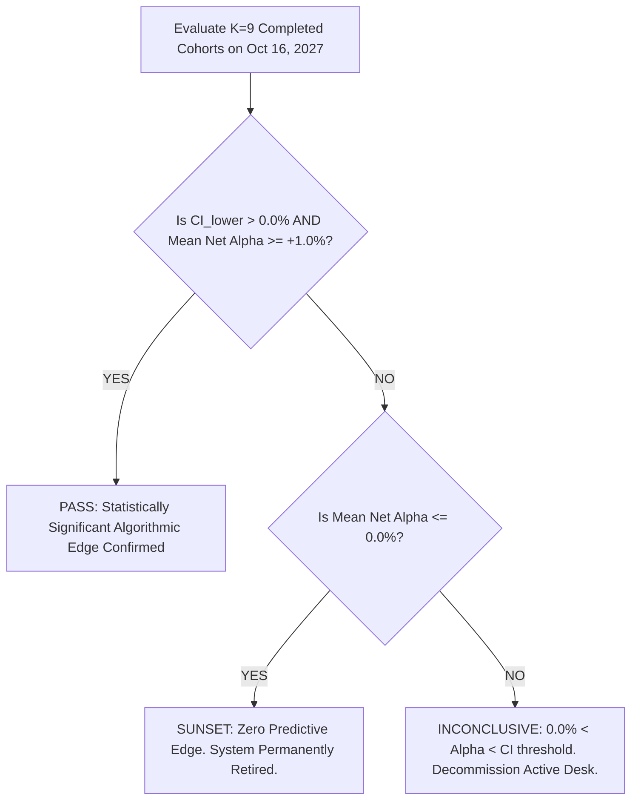

# 🏛️ TradeMatrix Forward Validation Protocol v2.1.1 (Final Pre-Registered Specification)

**Registration Date:** 16 October 2026, Friday  
**Document Status:** Final Pre-Registered Protocol v2.1.1 (Amended)  
**Reconciliation Reference:** [docs/one_page_research_summary.md](file:///c:/project/Trade_matrix/docs/one_page_research_summary.md)  
**Governance:** Institutional Empirical Research Protocol | Zero Advisory Tone | Educational Sandbox  

---

## 1. Executive Summary & Core Upgrades

This document resolves the **8 critical methodological requirements** identified in peer review. It establishes a rigorous, mathematically sound, dual-ledger forward testing architecture designed to test whether the Aladdin quantitative scoring engine produces genuine predictive alpha or random market noise.

```
+---------------------------------------------------------------------------------------------------------+
|                             FORWARD VALIDATION PROTOCOL v2.1.1 OVERVIEW                                 |
+---------------------------------------------------------------------------------------------------------+
| 1. DUAL-LEDGER SEPARATION   --> Ledger A: Primary Shadow (Fixed 90-Day, Fractional %/rupee, Zero SL/TP) |
|                             --> Ledger B: Secondary Live (₹25k Slots, Dynamic ATR Stop, 12% Target)    |
| 2. UNIFIED PRIMARY METRIC   --> Tool 10 Net Return minus Universe Exact Net Return (Cohort-Level Δ)     |
| 3. COHORT TIMELINE (K=9)    --> Monthly Schedule (1st Trading Day); Mid-July 2027 Freeze Cap = 9 Cohorts|
| 4. PILOT RUN ISOLATION      --> 16 Oct 2026 = Cohort 0 (Pilot); Cohort 1 starts Mon 02 Nov 2026 (NSE)   |
| 5. BETWEEN-COHORT INFERENCE --> Cross-cohort standard error (SE = s / sqrt(K)); No pooled pseudo-sample|
| 6. HONEST POWER ESTIMATE    --> Min Detectable Edge 3.85%/90d (~16.2% p.a.) based on ASSUMED 5.0% SD   |
| 7. STATUTORY FRICTION       --> Real Equity Delivery Schedule: ~0.385% on ₹25k (Zero Delivery Brokerage)|
| 8. REPRODUCIBILITY ENGINE   --> Dynamic Git HEAD lock (refuses dirty trees); Sector-Matched Control 2   |
+---------------------------------------------------------------------------------------------------------+
```

---

## 2. The 8 Critical Upgrades (Detailed Operational Specifications)

### Upgrade 1: Schedule, Capital Harmony & Cohort Timeline
* **Schedule Reconciliation:**
  - The schedule is strictly **Monthly** (executed automatically on the 1st trading day of each calendar month at 09:30 AM IST).
  - Bi-weekly runs are eliminated because overlapping 90-day holds would create 6–7 concurrent cohorts (~₹16L capital demand), breaching the ₹10,00,000 ceiling.
  - On a monthly schedule with a 90-day holding horizon, there are **at most 3 concurrent active live cohorts** (3 cohorts × ₹2,50,000 = ₹7,50,000), leaving a comfortable ₹2,50,000 cash buffer.
* **12-Month Calendar Deadline (16 October 2027) & Completed Cohort Count ($K=9$):**
  - To be evaluated on a complete 90-day holding basis before the hard deadline, a cohort must freeze on or before **mid-July 2027**.
  - Any cohort initiated in August, September, or October 2027 would remain uncompleted at the deadline.
  - Therefore, the protocol will evaluate exactly **$K = 9$ fully completed monthly cohorts** (November 2026 through July 2027).
* **Pilot Cohort 0 Designation:**
  - Freeze of 16 October 2026 is a mid-month manual run.
  - It is formally designated as **Cohort 0 (Pilot Verification Run)** and is **strictly quarantined from primary statistical inference**.
  - **Cohort 1 (Primary Series)** initiates automatically on the 1st trading day of November 2026 (**Monday, 02 November 2026**, verified against the official NSE holiday calendar).

---

### Upgrade 2: Dual-Ledger Architecture & Pre-Registered Timing
To prevent conflation between a pure selection test and tactical exit parameters:

```
+------------------------------------------------------------------------------------------------------+
| LEDGER A: PRIMARY SHADOW RESEARCH LEDGER       | LEDGER B: SECONDARY LIVE PAPER TRADING DESK         |
+------------------------------------------------+-----------------------------------------------------+
| • Purpose: Pure Stock Selection Validation     | • Purpose: Operational Execution & Tool Feasibility |
| • Horizon: Fixed 90 Calendar Days (Strict)     | • Horizon: Dynamic (Exits on Target/SL/RSI/90d)     |
| • Sizing: Fractional %-per-rupee (Exact 10.0%) | • Sizing: Integer Shares (~₹25,000 per slot)        |
| • Exits: Zero Stop Loss or Target Truncation   | • Exits: 12% Target, 2x ATR Dynamic SL, RSI > 70    |
| • Pricing: Official NSE Open (Entry), Close(90)| • Pricing: Real-time Live Market Ticks (Fyers API)  |
| • Primary Statistical Decision Rule Applied    | • Auxiliary Diagnostic & Execution Cost Audit       |
+------------------------------------------------------------------------------------------------------+
```

* **Ledger A Pre-Registered Timing Specification:**
  - **Scoring Timestamp:** Sourced strictly from EOD data up to Day $T-1$ Close. Zero lookahead into Day $T$ pricing.
  - **Entry Price:** Official Day $T$ Open (NSE 09:15–09:30 print) on freeze morning.
  - **Exit Price:** Day $T+90$ Close (if Day 90 is a weekend or NSE trading holiday, rolled forward to the Close of the first subsequent active NSE trading session).
  - **Corporate Actions & Dividends:** Individual stock prices are sourced from corporate-action dividend-adjusted archives to ensure parity with total return benchmarks.

---

### Upgrade 3: Unified Primary Metric, Control 1 & Control 2
To eliminate multi-hypothesis testing ($p$-hacking) and structural weighting discrepancies:
* **Why Nifty 50 TRI is Secondary:** Nifty 50 is market-cap weighted (top 5 stocks represent >40% of index variance), whereas the Tool basket is equal-weighted. An equal-weight basket naturally has higher small/mid-beta than Nifty 50.
* **The Unified Primary Metric ($\Delta_{\text{Cohort}}$):**
  For each completed cohort $k \in \{1, \dots, 9\}$:
  $$\Delta_k = R_{\text{Tool Top 10, Net, } k} - \overline{R}_{\text{Universe Equal-Weight, Net, } k}$$
  Where:
  - $R_{\text{Tool Top 10, Net, } k}$ is the equal-weighted 90-day net return of the 10 highest-ranked stocks in Cohort $k$ minus 0.385% statutory friction.
  - $\overline{R}_{\text{Universe Equal-Weight, Net, } k}$ is the **exact equal-weighted net return** across all $N \approx 96\text{--}100$ eligible stocks in the universe. (Because $E[\text{Random Basket}] \equiv \overline{R}_{\text{Universe}}$, calculating the exact universe net return eliminates Monte Carlo sampling noise from the primary $\Delta_k$).
* **Control 1: 1,000 Pseudo-Random Baskets (Percentile Diagnostic):**
  - 1,000 10-stock equal-weight random baskets are simulated with seed `int(YYYYMMDD)` to establish the empirical cross-sectional distribution, determining the Tool's exact percentile rank and empirical $p$-value.
* **Control 2: 1,000 Sector-Matched Random Baskets (Alpha Decomposition):**
  - To address defensive sector clustering (e.g. IT, Pharma, Auto), 1,000 random baskets are generated matching the exact sector distribution of Tool Top 10.
  - Decomposes excess return into:
    $$\text{Total } \Delta = \underbrace{(R_{\text{Tool}} - \overline{R}_{\text{Sector-Matched}})}_{\text{Stock Selection Skill}} + \underbrace{(\overline{R}_{\text{Sector-Matched}} - \overline{R}_{\text{Universe}})}_{\text{Sector Allocation Beta}}$$
* **Hypothesis Test Across Cohorts ($K=9$):**
  $$\overline{\Delta} = \frac{1}{K} \sum_{k=1}^K \Delta_k, \quad s_{\Delta} = \sqrt{\frac{\sum (\Delta_k - \overline{\Delta})^2}{K - 1}}, \quad SE(\overline{\Delta}) = \frac{s_{\Delta}}{\sqrt{K}}$$
  $$\text{95% Confidence Interval} = \left[\overline{\Delta} - t_{0.025, K-1} \times SE(\overline{\Delta}), \quad \overline{\Delta} + t_{0.025, K-1} \times SE(\overline{\Delta})\right]$$

---

### Upgrade 4: Between-Cohort Spearman Rank Correlation & Distribution Tracking
* **Full-Universe Score Distribution Tracking:**
  - For each cohort freeze, the full distribution of all $N$ universe scores is archived (`min`, `max`, `mean`, `median`, `std`, `top10_threshold`).
  - Verifies whether top picks are meaningfully separated from universe median or merely bunched in a narrow noise band.
* **Between-Cohort Evaluation:**
  - For each cohort $k$, calculate Spearman's rank correlation $\rho_k$ between Aladdin Composite Score at $T=0$ and forward 90-day returns across all eligible universe stocks.
  - Cross-cohort mean:
    $$\overline{\rho} = \frac{1}{K} \sum_{k=1}^K \rho_k, \quad SE(\overline{\rho}) = \frac{s_{\rho}}{\sqrt{K}}$$
  - **Robustness Non-Overlapping Subsample:** In addition to the 9 overlapping monthly cohorts, evaluate the 3 strictly non-overlapping cohorts (**Cohort 1 [Nov], Cohort 4 [Feb], Cohort 7 [May]**) as an independent validation check.

---

### Upgrade 5: Power Analysis, Detectable Edge & Single Decoupled Pass Hurdle
* **Power Estimation Based on Assumed Dispersion:**
  - An excess return standard deviation of $\sigma_{\Delta} \approx 5.0\%$ is an **assumed pre-study planning estimate** (based on Indian equity cross-sectional volatility), **NOT an empirical calculation from the incomplete single pilot cohort**.
  - For $K = 9$ completed cohorts, the planned standard error is:
    $$SE(\overline{\Delta}) \approx \frac{5.0\%}{\sqrt{9}} = 1.67\%$$
  - With $t_{0.025, 8} = 2.306$, clearing statistical significance requires $2.306 \times 1.67\% \approx \mathbf{+3.85\% \text{ per 90-day cohort (}\approx +16.2\% \text{ annualized)}}$.
* **Decoupled Pass Rule (Resolving the Dual-Hurdle Conflict):**
  - The previous rule (`mean > 3.85% AND CI_lower > 0`) conflated an assumed 5% SD with an empirical test. If the realized $s_{\Delta}$ is smaller (e.g. 2.0%), $\text{CI}_{\text{lower}} > 0$ occurs at $\overline{\Delta} \approx +1.54\%$, but an arbitrary 3.85% mean hurdle would spuriously block validation.
  - **The Pre-Registered Pass Rule is decoupled to two sound conditions:**
    1. **Statistical Significance:** $\text{CI}_{\text{lower}} > 0.0\%$ (the 95% confidence interval lower bound is strictly positive).
    2. **Economic Significance Floor:** $\overline{\Delta} \ge +1.0\%$ per 90 days (ensuring the edge is non-trivial after all execution realities).

---

### Upgrade 6: Fractional Sizing & Capital Ring-Fencing
* **Ring-Fenced Forward Testing Pool:**
  - The live forward test is allocated a dedicated, isolated capital pool: `FORWARD_TEST_CAPITAL_POOL = ₹10,00,000.0`.
  - Legacy paper trades (₹2.72L in 5 positions) are completely insulated in a separate legacy pool.
  - With monthly cadence, at most 3 cohorts are concurrent (₹2.5L × 3 = ₹7.5L peak exposure), fully fitting within the ₹10L pool.
  - If capital is exhausted, rejections on Ledger B are logged explicitly as `REJECTED_CAPITAL_EXHAUSTED`.
  - **Ledger A (Primary Shadow Research) is strictly unconstrained fractional %-per-rupee allocation (10.0% per scrip) and never experiences capital rejection.**
* **Identical Universe Eligibility Filter:**
  - Constituent of **Nifty 100** on freeze date $T=0$ with 30-day median daily turnover $\ge ₹10 \text{ Cr}$.

---

### Upgrade 7: Realistic Indian Delivery Statutory Friction Schedule
* **Broker Schedule Freeze (Zero Delivery Brokerage Standard):**
  - Discount broker equity delivery brokerage = ₹0.
* **Exact Cost Breakdown per Round-Trip Trade (Nominal ₹25,000):**
  1. **Brokerage:** ₹0.00 (Zero delivery fee).
  2. **STT (Securities Transaction Tax):** $0.10\%$ buy + $0.10\%$ sell = $0.20\%$.
  3. **Stamp Duty (State):** $0.015\%$ on buy turnover.
  4. **Exchange Turnover Fee (NSE):** $0.00297\%$ buy + $0.00297\%$ sell = $0.00594\%$.
  5. **SEBI Turnover Charges:** $0.0001\%$ round-trip.
  6. **GST (18% on Turnover & SEBI fees):** $0.18 \times 0.006\% \approx 0.0011\%$.
  7. **Depository DP Charges (CDSL/NSDL):** ₹15.93 per scrip on sell ($\frac{15.93}{25000} \approx 0.0637\%$).
  8. **Bid-Ask Spread & Market Impact Slippage:** $0.05\%$ entry + $0.05\%$ exit = $0.10\%$.
  $$\mathbf{\text{Total Frozen Statutory Friction}} = \mathbf{0.385\% \text{ (Locked in code as 0.385%)}}$$

---

### Upgrade 8: Reproducibility, Scheduler Automation & Calendar Enforcement
* **Automated APScheduler & Missed-Run Catch-Up:**
  - Automated cron job runs on weekdays at **09:30 AM IST**.
  - On backend startup, an automatic catch-up check verifies if the current session is the first trading day of the calendar month and no cohort has been frozen yet.
* **NSE Trading Calendar Utility:**
  - Trading days, holidays, and 90-day exit rollover dates are computed dynamically via official NSE holiday calendar rules ([backend/app/utils/nse_calendar.py](file:///c:/project/Trade_matrix/backend/app/utils/nse_calendar.py)).
* **Strict Git Tree Cleanliness Enforcement:**
  - Freeze script dynamically reads Git HEAD commit SHA.
  - **Refuses freeze if working tree is dirty (`git status --porcelain` check)**. Prevents uncommitted code execution.
* **Deterministic Random Seed:**
  - Deterministic seed $\text{Seed} = \text{int}(YYYYMMDD)$ guarantees 100% independent offline auditability.

---

## 3. Pre-Registered Decision Hurdle (Tri-State Protocol v2.1.1)

Evaluated strictly after the completion of all **$K = 9$ monthly cohorts** (October 16, 2027):



1. **Pass Condition (Validation):**
   - 95% Confidence Interval lower bound is strictly positive: $\text{CI}_{\text{lower}} > 0.0\%$.
   - Cross-cohort mean excess return meets the economic floor: $\overline{\Delta} \ge +1.0\%$ per 90 days.
2. **Inconclusive Condition ($0.0\% < \overline{\Delta}$ but $\text{CI}_{\text{lower}} \le 0.0\%$ or $\overline{\Delta} < +1.0\%$):**
   - The data is insufficient to reject the null hypothesis of luck/noise. The active descriptive desk is decommissioned without commercial claims.
3. **Sunset Condition ($\overline{\Delta} \le 0.0\%$):**
   - Aladdin composite score underperforms a monkey throwing 10 darts. The active stock selection engine is permanently decommissioned.
   - **Protection:** Evaluated strictly after all $K \ge 9$ cohorts have matured.

---

## 4. Implementation Roadmap & Verification Proofs

1. **Step 1: Backup `tradematrix.db`** $\to$ Created physical copy `tradematrix.db.bak_20261016`.
2. **Step 2: Database Migration** $\to$ Added `sector_exposure` and `score_distribution` columns to `forward_batches`. Full 96-stock universe saved in `universe_score_snapshots`.
3. **Step 3: Ring-Fenced Capital** $\to$ Added `FORWARD_TEST_CAPITAL_POOL = 1_000_000.0` in `backend/app/config.py`.
4. **Step 4: Implemented Engine Updates** in `backend/app/services/forward_test.py`:
   - Enforce clean git status and dynamically read HEAD SHA.
   - Exact universe net return computation for primary $\Delta$.
   - Control 2 (1,000 sector-matched random baskets).
   - Single decoupled pass rule ($CI_{\text{lower}} > 0$ and $\overline{\Delta} \ge 1.0\%$).
5. **Step 5: Automated Scheduler & NSE Calendar** $\to$ Added `nse_calendar.py`, weekday 09:30 AM cron, and startup catch-up trigger.
6. **Step 6: Cohort 0 (Pilot)** $\to$ Designated `PILOT`, isolated from primary inference. Cohort 1 set to Monday, 02 November 2026.
7. **Step 7: Reconciled Documentation** $\to$ Protocol v2.1.1 pre-registered.
8. **Step 8: Verified Tests** $\to$ `dry_run`, `py_compile`, `test_scorecard`, and `tsc --noEmit`.

---

## 4. Implementation Roadmap (Backend First $\to$ UI Last)

1. **Step 1: Backup `tradematrix.db`** $\to$ Create physical copy `tradematrix.db.bak_YYYYMMDD`.
2. **Step 2: Idempotent Database Migration** $\to$
   - Create table `forward_batches` (with dual-ledger tracking, git hash, regime, seed).
   - Create table `universe_score_snapshots` (full 100-stock score snapshot).
   - Add metadata columns to `paper_trades` with `experiment_arm = 'LEGACY_PRE_V2'` for existing 5 trades.
3. **Step 3: Update `DEFAULT_CAPITAL = 1_000_000.0`** in [backend/app/config.py](file:///c:/project/Trade_matrix/backend/app/config.py).
4. **Step 4: Implement `ForwardTestEngine`** in `backend/app/services/forward_test.py`:
   - Full-universe snapshotter ($N \ge 100$).
   - 1,000-basket Monte Carlo simulator.
   - Cross-cohort Spearman correlation calculator.
   - 0.385% real delivery friction calculator.
5. **Step 5: Offline Dry-Run Script** $\to$ Verify deterministic bootstrap, friction, and snapshot persistence.
6. **Step 6: Deploy Cohort 0 (Pilot Verification)** $\to$ Tagged `PILOT_COHORT_0`, Nifty base recorded, legacy trades archived.
7. **Step 7: Reconcile [docs/one_page_research_summary.md](file:///c:/project/Trade_matrix/docs/one_page_research_summary.md)** with Protocol v2.1.
8. **Step 8: UI Updates (Dashboard)** $\to$ Capital ₹10L display, compliant "Ranked Watchlist (Descriptive Algorithm)" table.
