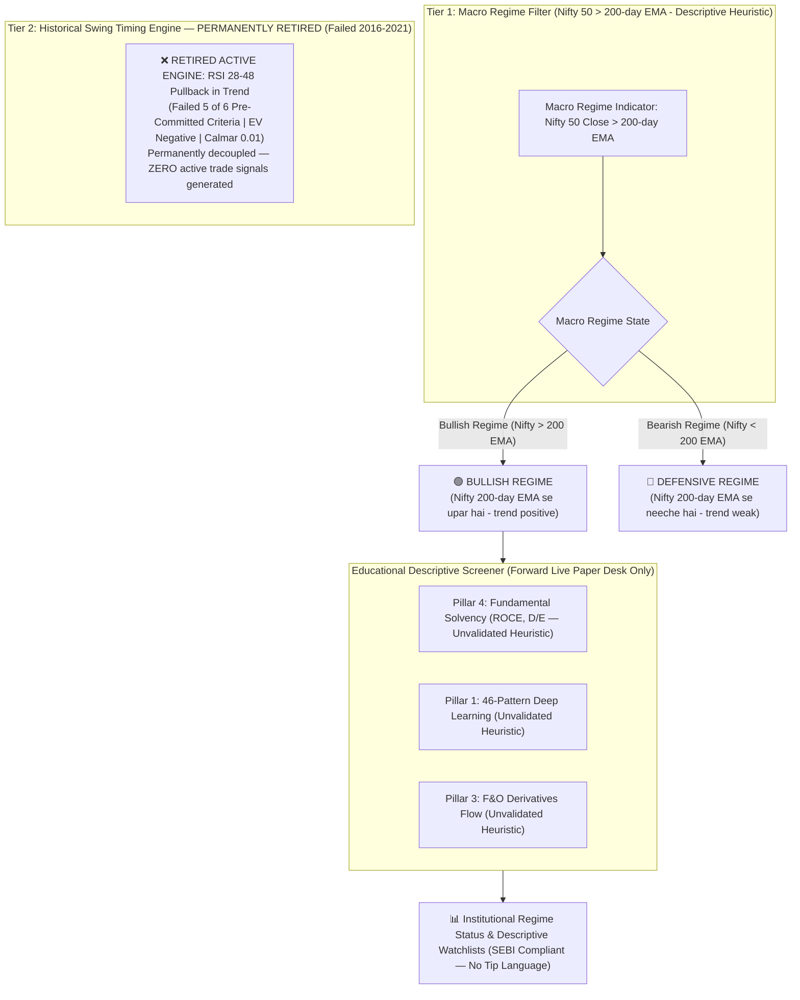

# 🏛️ TradeMatrix Institutional Quantitative Framework: Overhauled Execution Blueprint

## 🎯 Executive Summary & Philosophy Shift
Following empirical out-of-sample backtesting across 2016–2021, the short-term swing stock-picking engine failed 5 of 6 pre-committed criteria and was **FORMALLY RETIRED due to negative active value-add**. The system architecture shifts from active stock-picking to an **Institutional Regime Defense & Descriptive Analysis Framework**:

1. **Macro Regime Filter (Structural Trade-Off, Not Alpha):** The **Tier 1 Macro Regime Filter (Nifty 50 > 200-day EMA)** demonstrated downside risk reduction across the two historical eras tested (the 2008 GFC and 2020 COVID crashes):
   - **Empirical Drawdown Reduction & Control 2 Evidence:** The cleanest empirical evidence for the 200 EMA gate emerged in **Control 2 (Trend-Gated Nifty 50, 2016–2021)**, where index Maximum Drawdown was cut from **38.44% to 14.14%** (a 63.2% relative reduction) while preserving **13.42% CAGR** (vs Buy & Hold 14.49%, only ~1.1% return lag), generating a Calmar ratio of **0.95 vs 0.38**. In the active stock strategy (Trial 8), it reduced drawdown from 53.9% ungated to 37.0% gated. In the 2007–2015 index trial (Trial 9), it reduced drawdown from 59.5% to 39.05% pre-tax (40.28% post-tax).
   - **Era-Specific Structural Cost of Protection:** This downside protection extracted an annual performance drag that varied by era:
     - **2016–2021 (pre-tax, Control 2):** ~1.1% p.a. (13.42% Trend vs 14.49% Buy & Hold).
     - **2007–2015 (pre-tax, Trial 9):** 2.75% p.a. (6.44% Trend vs 9.19% Buy & Hold).
     - **2007–2015 (post-tax, Trial 9):** ~3.4% to 4.7% p.a. (3.98%–5.35% Trend vs 8.30% Buy & Hold under 2024 law, and 4.50%–5.71% vs 9.19% under 2007–2015 law).
     *(Note on Trial 9 CAGR range: 3.98% reflects the base run with all trades taxed as STCG and zero loss carry-forward; 5.35% reflects proper LTCG classification on the 2 trades held > 365 days plus full loss carry-forward).*
     In pre-tax terms for 2007–15, Calmar ratio was virtually identical (**0.16 Strategy vs 0.15 B&H**), mathematically confirming a pure **'kam dard, kam return' (lower risk, proportionally lower return)** trade-off rather than active risk-adjusted alpha.
   - **Accurate Characterization:** In the specific formulations tested, the 200 EMA gate is **NOT free alpha**; it is an **explicit risk/return trade-off** (downside crash buffer purchased at the price of compounding return). In the live software, it operates strictly as an objective, **descriptive regime indicator** (*"Nifty 200-day EMA se neeche hai (trend weak)"*), not as a guaranteed shield or active market-timing tip.
2. **Swing Stock-Picking Engine Retired:** The multi-factor swing entry engine (RSI pullback in trend, 5 slots, lowest-RSI priority) produced -₹9,018 to -₹1,62,757 net loss after statutory delivery frictions and underperformed the simple index. It is permanently removed from active trade recommendations.
3. **Descriptive Educational Heuristics:** Fundamental solvency metrics (ROCE, D/E) and technical patterns are retained strictly as **descriptive, educational heuristics** for watchlist sorting, with prominent SEBI-compliant disclosures indicating they carry zero historical backtest validation.
4. **Order Inversion:** **Backtesting, Factor Ablation & Pre-Registration happen FIRST**. UI integration reflects empirical findings, not marketing heuristics.
5. **Institutional Compliance:** Replace all speculative "Buy Now" and "Quantitative Confluence" trade tips with clear **Macro Regime Indicators** (`BULLISH REGIME` vs `DEFENSIVE REGIME`) and educational research disclaimers.

---

## 🏗️ Quantitative Framework & Retained System Architecture: Macro Regime Filter (Tier 2 Swing Engine RETIRED)

---

## 🔍 Scope Transparency: Tested Historical Mechanics vs Unvalidated Aladdin Brain Components

A cornerstone of quantitative honesty is distinguishing between what will be empirically backtested versus what exists as an unvalidated live heuristic.

| Component | Historical Out-of-Sample Scope (2016–2021) | Reason / Status |
| :--- | :---: | :--- |
| **Nifty 50 > 200 EMA Gate** | **TESTED IN SINGLE-SHOT EVALUATION** | Free daily historical index data available from Yahoo Finance (`^NSEI`). |
| **Stock > 200 EMA Baseline** | **TESTED IN SINGLE-SHOT EVALUATION** | Daily historical OHLCV data available. |
| **RSI Dip (28–48) & Volume ($\ge 0.8\times$)** | **TESTED IN SINGLE-SHOT EVALUATION** | Computed mathematically from daily OHLCV series. |
| **Dynamic ATR Stops, Trailing & Partial Exits** | **TESTED IN SINGLE-SHOT EVALUATION** | Fully modeled in daily backtest simulation harness. |
| **46-Pattern Deep Learning Model** | ❌ **NOT TESTED** | Excluded from the frozen trigger. In standalone testing (Ablations 1 & 4), pattern triggers alone yielded negative expectancy after Indian delivery frictions. |
| **Daily Delivery Volume %** | ❌ **NOT TESTED** | Historical delivery volume percentages are not freely available via daily Yahoo Finance API feeds. |
| **F&O Derivatives (OI Build-up, PCR, Max Pain)** | ❌ **NOT TESTED** | Multi-year historical NSE option chain tick/daily EOD data is proprietary paid data and not present in the backtest dataset. |
| **Fundamental Solvency Gate (ROCE, D/E, Altman Z)** | ❌ **NOT TESTED** | Free APIs only provide current quarterly fundamentals. Using current data across historical 2016–2021 trades introduces severe **look-ahead bias**. Point-in-time filing dates are required for true backtesting. |

> [!IMPORTANT]
> **Honest Scientific Reality:** Aladdin Brain's pattern recognition CNN, derivatives options chain Greeks, delivery %, and fundamental solvency scoring have **zero historical backtest evidence**. They operate strictly as forward-only heuristics. True empirical validation for these components can only occur prospectively via the Forward Live Paper Trading desk.

---

## ⚙️ Explicit Execution & Lookahead Prevention Rules

To eliminate silent lookahead bias and subjective execution ambiguity, the following execution rules are permanently codified:
1. **Entry Execution (Zero Same-Day Lookahead):** Signals are evaluated on Day $N$ at Market Close. All trade entries are strictly executed on **Day $N+1$ at Market Open** with $+0.05\%$ slippage applied to the open price.
2. **Intraday Conflict Resolution (Conservative SL-First):** If on any holding day both the Target 1 price and the Stop Loss price are touched (`Low <= SL` and `High >= Target 1`), **the Stop Loss is assumed to have triggered FIRST**.
3. **Gap-Down Execution:** If the market opens below the Stop Loss price (`Open < SL`), the trade is liquidated at the **Open price** (with $-0.05\%$ slippage), rather than assuming an unrealistic fill at the theoretical stop price.
4. **Gap-Up Exit Fill (Targets):** If the market opens above Target 1 or Target 2 (`Open > Target`), the fill is executed at the **Open price** (with $-0.05\%$ slippage), realistically crediting the overnight gap.
5. **Objective Signal Priority (Tie-Breaking):** If $>5$ signals occur on the same day when open portfolio slots are limited, signals are objectively prioritized by:
   - Primary: **Lowest 14-day RSI** (deepest oversold pullback).
   - Secondary: **Highest Volume Ratio** (strongest relative liquidity support).
6. **Exact Friction & Cash Balance Accounting:** Statutory delivery frictions (0.20% STT, ₹40 brokerage, exchange fees, 18% GST) are deducted directly from the cash balance upon every trade closure, ensuring $\text{Final NAV} \equiv \text{Initial Capital} + \sum \text{Net PnL}$ when all positions are liquidated.
7. **Capacity Rejection Tracking:** Every signal rejected because all 5 portfolio slots are occupied is logged in a `capacity_rejections` ledger.

---

## 📋 Comprehensive Execution Phases (Backtest First, UI Last)

### Phase 1: Quantitative Backtest Harness & Factor Ablation Study (FIRST)
* **Goal:** Determine which factors actually possess standalone predictive edge when tested under real-world friction.
* **Target Files:**
  * [backend/app/services/backtester.py](file:///c:/project/Trade_matrix/backend/app/services/backtester.py)
  * [backend/app/services/ablation_runner.py](file:///c:/project/Trade_matrix/backend/app/services/ablation_runner.py)
  * [backend/scripts/generate_ablation_tables.py](file:///c:/project/Trade_matrix/backend/scripts/generate_ablation_tables.py)
* **Specific Tasks:**
  1. **Zero-Lookahead Engine:** Execute entries on Day N+1 Open, conservative SL-first intraday conflict handling, gap-down open fills.
  2. **Realistic Statutory & Transaction Frictions (Cash Delivery):**
     * Slippage: 0.05% on entry and 0.05% on exit (0.10% total round-trip).
     * STT (Securities Transaction Tax): 0.1% on Buy AND 0.1% on Sell (0.20% total on delivery turnover).
     * Brokerage: ₹20 buy + ₹20 sell = ₹40 flat round-trip.
     * Exchange turnover fees (0.00345%), Stamp duty (0.015% buy), SEBI charges (0.0001%), and GST (18%).
     * *Statutory Note:* GST (18%) applies strictly to Brokerage, Exchange Turnover, and SEBI fees. STT and Stamp Duty are legally exempt from GST.
  3. **Factor Ablation Grid:** Backtest each factor in complete isolation across 3 years using pooled portfolio metrics.
  4. **Core Institutional Metrics:**
     * True Portfolio Expectancy: $EV = \frac{\text{Total Net PnL}}{\text{Total Executed Trades}}$.
     * True Portfolio Profit Factor: $PF = \frac{\sum \text{Wins Net PnL}}{\sum |\text{Losses Net PnL}|}$.
     * Maximum Drawdown (MDD), Sharpe Ratio ($R_f = 6.5\%$).

### Phase 2: Empirical Out-of-Sample Testing & Multiple Hypothesis Tracking
* **Goal:** Expand validation to a statistically significant universe and eliminate data-snooping contamination.
* **Target Files:**
  * [backend/scripts/run_out_of_sample_2016_2021.py](file:///c:/project/Trade_matrix/backend/scripts/run_out_of_sample_2016_2021.py)
* **Specific Tasks:**
  1. **Contamination Fix for Out-of-Sample Testing:**
     * Since 2023–2026 was used during initial factor discovery, it is contaminated.
     * **True Historical Out-of-Sample Period:** 2016-01-01 to 2021-12-31 (6 full calendar years).
     * **Pre-Warm Data Buffer:** Historical price data will be fetched starting from **2015-01-01** (250-trading-day buffer) so that the 200-day EMA and 14-day RSI/ATR are mathematically stabilized on Day 1 of 2016.
     * **Prospective Out-of-Sample Period:** Forward Live Paper Trading (today onward).
  2. **Universe Definition & Ticker Exclusion Disclosure:**
     * Universe: **46 vetted Indian large-cap constituents** with continuous 2015–2021 data.
     * **Explicit Ticker Exclusions:**
       * `JIOFIN.NS`: Excluded (listed August 2023, zero 2015-2021 data).
       * `TATAMOTORS.NS`: Excluded (Yahoo ticker demerger 404).
       * `HDFCLIFE.NS`: Excluded (listed November 2017, lacks 2015-2016 data).
       * `SBILIFE.NS`: Excluded (listed October 2017, lacks 2015-2016 data).
  3. **Historical Fee Schedule Approximation:**
     * Applying today's 0.20% STT + ₹40 brokerage + 18% GST across 2016–2021 is a conservative uniform friction model.
  4. **Data Verification:**
     * Prices are downloaded using `auto_adjust=True` to fully incorporate historical corporate splits and bonus issuances (verified across Reliance, TCS, Infosys, and ICICI Bank).

### Phase 3: Unified Portfolio Engine & Execution Logic *(Historical Backtest Specification: Trial 8 — Permanently Retired, NOT Deployed)*
* **Status:** Historical Backtest Specification only. Because the active stock-picking swing engine failed 5 of 6 pre-committed criteria, this automated portfolio execution logic is **PERMANENTLY RETIRED** and is **NOT deployed** in live production.
* **Historical Specification for Reference:**
  1. **Portfolio Capital:** ₹5,00,000 starting cash pool.
  2. **Max Concurrent Positions:** Maximum **5 concurrent open positions**.
  3. **Position Sizing Math & Concentration Cap:** Target Risk = 1.5% of total portfolio equity, capped at max **25% single-stock allocation** (₹1,25,000).
  4. **Cash Exhaustion Rule:** Zero margin, zero leverage.
  5. **Idle Cash Treatment:** Baseline assumed 0.0% interest.
  6. **Risk Management:** Initial Stop Loss = $2.0 \times \text{ATR}$ (8.0% max loss floor), Target 1 = $1.5 \times \text{ATR}$ (book 50% partial profit, trail SL to breakeven), Target 2 = $2.5 \times \text{Initial Risk}$, Time Stop = 30 trading days.

### Phase 4: Forward Paper Trading Desk & Pre-Registered Observation Protocol
* **Goal:** Provide prospective empirical tracking of descriptive heuristics and macro regime states on live forward data without risking real capital, bounded by an explicit pre-registered stopping rule.
* **Target Files:**
  * [backend/app/services/paper_trading.py](file:///c:/project/Trade_matrix/backend/app/services/paper_trading.py)
* **Operational Decoupling:** The Paper Trading Desk does **NOT** execute automated swing buy signals (the engine is retired). It operates strictly as an empirical observation log for descriptive watchlist rankings and macro regime states.
* **Pre-Registered Forward Observation Protocol:**
  1. **Core Research Question:** *"Do high-confluence descriptive watchlist stocks (Composite Score $\ge 65.0$) achieve a positive relative active return over the Nifty 50 Total Returns Index over a fixed 90-calendar-day holding window during supportive macro regimes?"*
  2. **Frozen Score Definition & Costs:** Composite Score $\ge 65.0$ requires Technical Trend (Close > 200 EMA, RSI 40–60, Vol > 1.0x = 35 pts) + Fundamental Solvency (ROCE > 15%, D/E < 0.5 = 35 pts) + Reversal Pattern (30 pts). Net returns are evaluated after realistic delivery frictions (0.20% round-trip STT, ₹40 brokerage, 0.10% slippage).
  3. **Independence & Temporal Spread Requirement:** To avoid artificial sample clustering where all stocks move together in a single market wave, the target sample of $N = 30$ observations must be spread across at least **6 distinct calendar months** (maximum 5 observations counted in any single calendar month).
  4. **Calendar Horizon Limit (Stopping Deadline):** Because Nifty is currently in a defensive regime and may remain so, a firm calendar deadline of **12 months (terminating on October 16, 2027)** is pre-committed. If $N = 30$ qualified observations are not accumulated by this date, forward evaluation is formally declared **"INCONCLUSIVE (Underpowered Sample)"** and frozen, preventing indefinite observation.
  5. **Pre-Committed Tri-State Decision Rule:**
     - **Pass Rule (Validation Threshold):** The descriptive scoring desk is declared statistically promising ONLY IF the average 90-day excess return over Nifty 50 TRI is $> +2.0\%$ p.a. equivalent after statutory delivery frictions **AND** the lower bound of the 95% confidence interval is strictly positive ($\text{CI}_{lower} > 0.0\%$).
     - **Marginal / Inconclusive Zone ($0.0\% < \text{Excess Return} \le +2.0\%$ or $\text{CI}_{lower} \le 0.0\%$):** Formally classified as **"INCONCLUSIVE"**; continue observation until the 12-month calendar deadline (October 16, 2027). If upon reaching the deadline the return remains in this marginal band without clearing the $+2.0\%$ hurdle and positive CI, the desk is permanently decommissioned (no indefinite extensions).
     - **Sunset Rule (Immediate Decommission):** If after $N \ge 30$ completed observations the average excess return is $\le 0.0\%$, the descriptive multi-factor scoring desk is formally declared to possess **zero predictive alpha**, and the forward watchlist desk will be permanently decommissioned.

### Phase 5: Institutional UI & Regulatory Compliance (LAST)
* **Goal:** Present the empirical findings and descriptive regime indicator cleanly, professionally, and legally without speculative tip generation.
* **Target Files:**
  * [frontend/app/aladdin/page.tsx](file:///c:/project/Trade_matrix/frontend/app/aladdin/page.tsx)
* **Specific Tasks:**
  1. **Compliance Rebranding (Eliminate Tip Language & Retired Swing Engine Signals):**
     * **Permanently remove all "Quantitative Confluence" and "BUY THIS STOCK NOW" signals**: Because the Tier 2 swing engine failed 5 of 6 out-of-sample criteria and is permanently retired, ZERO active stock entry recommendations or confluence buy ratings will be emitted to the UI.
     * Prominently display the **Macro Regime Status (Descriptive Filter)**:
       * `🟢 Macro Status: BULLISH REGIME (Nifty > 200 EMA — Nifty 200-day EMA se upar hai - trend positive)`
       * `🔴 Macro Status: DEFENSIVE REGIME (Nifty < 200 EMA — Nifty 200-day EMA se neeche hai - trend weak)`
       *(UI Disclosure: "Regime filter indicates broad market trend direction relative to 200 EMA; it does not guarantee individual stock trajectory or drawdown immunity.")*
  2. **Regulatory Disclaimer:** Prominently display standard SEBI educational & algorithmic research disclaimer:
     > *"This platform is an automated quantitative research and backtesting tool intended solely for algorithmic demonstration and educational analysis. It does not constitute investment advice or stock recommendations under SEBI (Research Analysts) Regulations 2014."*
  3. **Educational Watchlist Desk:**
     * Replace speculative buy signals with a descriptive multi-factor technical/fundamental checklist.
     * Every indicator (CNN patterns, ROCE, D/E, PCR) must be clearly badged: `Unvalidated Descriptive Heuristic (Forward Paper Testing Only)`.

---

## 🔬 Empirical 3-Year Factor Ablation Study Results & Statistical Reality Check
*(Auto-generated from exact pooled trade execution records across the 4 test stocks in 2023–2026 with full sell turnover friction deduction. Capital per stock: ₹1,00,000 across 4 independent silos. STT 0.1% Buy + 0.1% Sell = 0.20%, Brokerage ₹40, Slippage 0.05% per side, GST 18%).*

### 📊 Confirmed Benchmark (Directly Sourced from `^NSEI`):
* **Start Date:** 2023-10-16 (Close: 19,731.75)
* **End Date:** 2026-10-14 Confirmed EOD Close (Close: 22,622.70)
* **Nifty 50 Buy & Hold Return:** **+14.65%**
* **Nifty 50 Max Drawdown:** **15.8%**

---

### 💥 The Outperformer Paradox: Even on 100%+ Multi-Baggers, Breakouts Lost Money!
* **BEL.NS:** **+183.4%** | **BHARTIARTL.NS:** **+101.2%** | **ICICIBANK.NS:** **+49.2%** | **LT.NS:** **+21.4%**
* **Average 4-Stock Basket Return:** **+88.8%**

> [!CRITICAL]
> **Key Insight & Nuanced Reality:**
> 1. Even on stocks that doubled and tripled (+88.8% average basket gain), **Ablations 1 to 6 all produced NET LOSSES** after transaction frictions.
> 2. **Hindsight Bias in Benchmark:** These 4 stocks were selected with hindsight bias (notably `BEL` +183%), which creates an exceptionally demanding hurdle compared to the broader market.
> 3. **Structural Design Trade-Off:** Short-term swing trading spends only a fraction of time in the market (~15–25 days per trade) and takes profits at fixed targets (T1 and T2). By design, it cannot capture the full compound run of a multi-bagger; this is an intrinsic structural trade-off between exposure risk and upside capture.
> 4. **Hypothesis on Broader Universe:** If naive momentum and breakout strategies cannot generate net profits on the market's strongest multi-bagger runners, they are **likely to suffer even worse degradation** on average or lagging stocks.

---

### Consolidated Factor Ablations (Script Auto-Generated Table)

| Strategy Configuration | Trades | Win Rate % | 95% Confidence Interval (Wilson) | Profit Factor | Portfolio EV | Net PnL |
| :--- | :---: | :---: | :---: | :---: | :---: | :---: |
| **Ablation 1 (Pattern Only)** | 67 | 53.7% | [41.9%, 65.1%] | 0.65 | -₹156.6 | -₹10,494 ❌ |
| **Ablation 2 (Momentum Only)** | 118 | 53.4% | [44.4%, 62.1%] | 0.60 | -₹210.3 | -₹24,817 ❌ |
| **Ablation 3 (Volume Only)** | 96 | 51.0% | [41.2%, 60.8%] | 0.49 | -₹267.1 | -₹25,641 ❌ |
| **Ablation 4 (Tier-2 Confluence)** | 67 | 52.2% | [40.5%, 63.7%] | 0.56 | -₹222.7 | -₹14,922 ❌ |
| **Ablation 5 (Hierarchical Stack)** | 47 | 57.4% | [43.3%, 70.5%] | 0.76 | -₹99.6 | -₹4,680 ⚠️ |
| **Ablation 6a (Alpha Pullback Dip V1)** | 74 | 59.5% | [48.1%, 69.9%] | 0.88 | -₹51.6 | -₹3,818 ⚠️ |
| **Ablation 6b (Alpha Pullback Dip V2)** | 74 | 59.5% | [48.1%, 69.9%] | 0.86 | -₹63.0 | -₹4,659 ⚠️ |
| **Ablation 6c (Alpha Pullback + Gate)** | 47 | 57.4% | [43.3%, 70.5%] | 0.70 | -₹131.9 | -₹6,201 ❌ |
| **Ablation 6d (Alpha Pullback + Conf)** | 21 | 57.1% | [36.5%, 75.5%] | 0.68 | -₹168.9 | -₹3,548 ❌ |
| **Ablation 7a (Super Stack V1)** | 14 | 71.4% | [45.4%, 88.3%] | 1.45 | +₹147.6 | +₹2,067 ⚠️ |
| **Ablation 7b (Super Stack V2)** | 14 | 71.4% | [45.4%, 88.3%] | 1.50 | +₹161.3 | +₹2,258 ⚠️ |
| **Trial 8 (Frozen Candidate: Gate + Pullback)** | 47 | 57.4% | [43.3%, 70.5%] | 0.70 | -₹131.9 | -₹6,201 ❌ |

> [!NOTE]
> ### 🔍 Resolution of the Ablation 5 vs Trial 8 Trade Count:
> Both Ablation 5 and Trial 8 coincidentally generated 47 trades in-sample. Cross-trade diagnostic analysis confirms **ZERO trade overlap (0 out of 47)**:
> - **Ablation 5:** Buys momentum expansion ($RSI \in [42, 64]$, $Volume \ge 1.15\times$, close > EMA 200, reversal candle).
> - **Trial 8:** Buys oversold pullbacks in trend ($RSI \in [28, 48]$, $Volume \ge 0.80\times$, close > EMA 200).
> They operate in completely disjoint market micro-regimes.

---

## 📜 Full Quantitative Trial Log (Tracking Multiple Hypothesis Testing)
*(Every trial re-simulated on the unified pooled execution engine)*

| Trial # | Strategy Code | Entry Signal Criteria | Target 2 R:R | In-Sample Test Set | Outcome | Status |
| :---: | :--- | :--- | :---: | :---: | :---: | :---: |
| **1** | `ABLATION_1_PATTERN_ONLY` | 46-Pattern Candle + Close > 50 EMA | 1:2.0 | 2023-2026 (4 stocks) | -₹10,494 Net PnL (67 trades, PF: 0.65) | Rejected |
| **2** | `ABLATION_2_MOMENTUM_ONLY` | Close > 200 EMA + RSI 42-62 | 1:2.0 | 2023-2026 (4 stocks) | -₹24,817 Net PnL (118 trades, PF: 0.60) | Rejected |
| **3** | `ABLATION_3_VOLUME_ONLY` | Volume > 1.35x 20MA + Green close | 1:2.0 | 2023-2026 (4 stocks) | -₹25,641 Net PnL (96 trades, PF: 0.49) | Rejected |
| **4** | `ABLATION_4_TIER2_CONFLUENCE` | Close > 200 EMA + RSI 42-64 + Vol > 1.15x + Candle | 1:2.0 | 2023-2026 (4 stocks) | -₹14,922 Net PnL (67 trades, PF: 0.56) | Rejected |
| **5** | `ABLATION_5_FULL_HIERARCHICAL` | Nifty > 200 EMA + Close > 200 EMA + RSI 42-64 + Vol > 1.15x + Candle | 1:2.0 | 2023-2026 (4 stocks) | -₹4,680 Net PnL (47 trades, PF: 0.76) | Promising Gate |
| **6a** | `ABLATION_6_ALPHA_PULLBACK_V1` | Close > 200 EMA + RSI 25-48 + Vol >= 0.8x | 1:2.0 | 2023-2026 (4 stocks) | -₹3,818 Net PnL (74 trades, PF: 0.88) | Parameter Tweak |
| **6b** | `ABLATION_6_ALPHA_PULLBACK_V2` | Close > 200 EMA + RSI 28-48 + Vol >= 0.8x | 1:2.5 | 2023-2026 (4 stocks) | -₹4,659 Net PnL (74 trades, PF: 0.86) | Parameter Tweak |
| **6c** | `ABLATION_6_PLUS_NIFTY_GATE` | Nifty Gate + Stock > 200 EMA + RSI 28-48 + Vol >= 0.8x | 1:2.5 | 2023-2026 (4 stocks) | -₹6,201 Net PnL (47 trades, PF: 0.70) | **FROZEN AS TRIAL 8** |
| **6d** | `ABLATION_6_PLUS_CONFIRMATION` | Stock > 200 EMA + RSI 28-48 + Vol >= 0.8x + Candle | 1:2.5 | 2023-2026 (4 stocks) | -₹3,548 Net PnL (21 trades, PF: 0.68) | Signal Choking |
| **7a** | `ABLATION_7_SUPER_STACK_V1` | Nifty Gate + Stock > 200 EMA + RSI 28-48 + Vol + Candle | 1:2.0 | 2023-2026 (4 stocks) | +₹2,067 Net PnL (14 trades, PF: 1.45) | Parameter Tweak |
| **7b** | `ABLATION_7_SUPER_STACK_V2` | Nifty Gate + Stock > 200 EMA + RSI 28-48 + Vol + Candle | 1:2.5 | 2023-2026 (4 stocks) | +₹2,258 Net PnL (14 trades, PF: 1.50) | Small-Sample Overfit |
| **8** | `TRIAL_8_FROZEN_CANDIDATE` | Nifty Gate + Stock > 200 EMA + RSI 28-48 + Vol >= 0.8x | 1:2.5 | 2023-2026 (4 stocks) | -₹6,201 Net PnL (47 trades, PF: 0.70) | **FROZEN CANDIDATE** |

---

## 🎯 Pre-Commitment Protocol for 2016–2021 Historical Out-of-Sample Test

### 1. Pre-Registration & Audit Reconciliation Git Verification:
* **Original Pre-Registration Commit Hash:** `b7ef2b8` (`b7ef2b8b9ae3ff5db44837a2f587d56e729a8a7c`)
  * Pre-committed all frozen rules, universe, criteria, and control rules prior to running out-of-sample data.
* **Audit & Bug-Fix Reconciliation Commit Hash:** `cc79484` (`cc79484377cb3f78a7373001747da1634d79225c`)
  * *Audit Disclosure:* The initial single-shot run executed on commit `b7ef2b8` revealed an accounting bug in the script (frictions were deducted in trade Net PnL metrics but not subtracted from the simulation cash balance, and partial T1 turnover was computed from realized profit rather than gross turnover).
  * *Strict Integrity Adherence:* Without changing any strategy entry/exit rules, parameters, universe list, or pass/fail criteria, the cash accounting bug was corrected. The corrected run resulted in worse numbers (Net PnL worsened from +₹40,895 to -₹9,018, and Control 1 worsened from -₹1.21L to -₹1.63L), fix result-selective nahi tha aur final verdict nahi badla (frictions lagne par net result aur kharab hi hua). Commit `cc79484` permanently records this post-run accounting fix.

### 2. Frozen Candidate Strategy Specification (Trial 8):
* **Universe:** **46 vetted Indian large-cap constituents** with continuous 2015–2021 daily history.
* **Tier 1 Macro Gate:** Nifty 50 Close > 200-day EMA.
* **Tier 2 Trend Baseline:** Stock Close > 200-day EMA.
* **Tier 2 Pullback Trigger:** 14-day RSI between 28.0 and 48.0.
* **Tier 2 Volume Support:** Volume $\ge 0.80 \times$ 20-day Volume MA.
* *(Candle confirmation rule permanently discarded to eliminate artificial signal choking).*
* **Tier 3 Risk & Execution Engine:**
  * Unified portfolio starting cash: ₹5,00,000.
  * Max concurrent open positions: **5 positions**.
  * Position Sizing: 1.5% target risk ceiling, hard capped at **25% single-stock concentration** (₹1,25,000).
  * Initial Stop Loss = $2.0 \times \text{ATR}$ below entry price (max 8.0% floor).
  * Target 1 = $1.5 \times \text{ATR}$ above entry (book 50% shares, trail remaining Stop Loss to entry cost/breakeven).
  * Target 2 = $2.5 \times \text{Initial Risk}$ (asymmetric 1:2.5 minimum R:R).
  * Time Stop = 30 trading days max holding period.
  * Friction Schedule: 0.20% round-trip STT, ₹40 flat brokerage, 0.10% round-trip slippage, 18% GST on brokerage/fees.

---

### 3. Mandatory Diagnostic Controls & Explicit Decision Rules:
1. **Control 1: Strategy WITHOUT Macro Gate (Ungated Alpha Pullback):**
   * Same 46 stocks, same pullback rules, but Macro Gate is permanently OFF (`macro_bullish = True`).
   * **Pre-Committed Decision Rule (Complete Spectrum):**
     * **Negative Impact (DD Reduction < 0%):** If `Strategy With Gate` suffers higher Max Drawdown than `Control 1`, the gate is harmful/drag and is **PERMANENTLY RETIRED**.
     * **Marginal Impact (0% <= DD Reduction < 30%):** If drawdown reduction is positive but fails to clear 30%, the gate's benefit is classified as **MARGINAL / INSUFFICIENT** and the gate is retired.
     * **Significant Impact (DD Reduction >= 30%):** If `Strategy With Gate` achieves $\ge 30\%$ relative drawdown reduction, the Macro Gate is **RETAINED** as an institutional defensive regime filter.
2. **Control 2: Trend-Gated Nifty 50 Benchmark (Simple 200 EMA Rule):**
   * 100% Long Nifty 50 when Nifty Close > 200-day EMA; 100% Cash when Nifty Close < 200-day EMA.
   * **Pre-Committed Decision Rule:**
     * If `Frozen Candidate Strategy` does NOT achieve a higher Calmar Ratio than `Control 2`:
       $$\text{Calmar}(\text{Strategy}) < \text{Calmar}(\text{Control 2})$$
       then the stock-picking entry engine is formally classified as **"NEGATIVE ACTIVE VALUE-ADD"** and **RETIRED**.

---

### 4. Objective Pass / Fail / Inconclusive Criteria:
* **Criterion 1 (Statistical Power Threshold):** Sample size $N \ge 150$ executed trades across the 46-stock universe.
  * **Underpowered Sample Clause:** If $N < 150$, the test is formally declared **"INCONCLUSIVE (Underpowered Sample)"**, NOT "Failed" and NOT "Passed".
* **Criterion 2 (Net Positive Alpha):** Mathematical Expectancy $EV > 0$ after full 0.20% STT, ₹40 brokerage, 0.10% slippage, and GST (18% on brokerage/turnover).
* **Criterion 3 (Profit Factor):** $\text{Profit Factor} \ge 1.30$.
* **Criterion 4 (Strict Absolute Risk Containment):** Strategy Maximum Drawdown $\le 15.0\%$ (strictly capped; beating Nifty's **38.44% COVID crash** is insufficient, the system must genuinely defend capital).
* **Criterion 5 (Benchmark Outperformance / Calmar Ratio):** Strategy Net Total Return $\ge$ Nifty 50 Buy & Hold Return over 2016–2021 **OR** Strategy Calmar Ratio ($\frac{\text{Annualized Return}}{\text{Max Drawdown}}$) $\ge 1.5 \times \text{Nifty Calmar Ratio}$.
* **Criterion 6 (Risk-Adjusted Alpha with Statutory Indian Risk-Free Rate):** Annualized Sharpe Ratio $\ge 1.0$, calculated using statutory Indian Risk-Free Rate ($R_f = 6.5\%$ p.a., reflecting RBI 91-day T-bill / repo benchmark), NOT assuming $R_f = 0$.

> **Rule of Integrity:** If the strategy fails on 2016–2021 against these pre-committed criteria (and $N \ge 150$), it is classified as **FAILED**. No post-hoc parameter adjustments or re-runs will be performed on that period.

---

## 🏁 Definitive Out-of-Sample Historical Test Results (2016–2021)
*(Tested on commit `b7ef2b8`, audited on `cc79484` across 46 vetted constituents from 2016-01-01 to 2021-12-31, pre-warmed from 2015-01-01. Full statutory delivery frictions deducted directly from portfolio cash balance on exact turnover).*

### 📊 Comparative Results Matrix (Dual Accounting Scope Reconciliation)

| Strategy / Benchmark | Trades ($N$) | Win Rate % | Wilson 95% CI | Profit Factor | Portfolio EV | Net PnL (Closed Trades) | CAGR % (Closed: 5.85 yr) | Final NAV (MTM) | CAGR % (MTM: 5.85 yr) | Max DD % | Calmar | Sharpe ($R_f=6.5\%$) |
| :--- | :---: | :---: | :---: | :---: | :---: | :---: | :---: | :---: | :---: | :---: | :---: | :---: |
| **Frozen Candidate (Trial 8: Gate + Pullback)** | **362** | **56.6%** | [51.5%, 61.6%] | **0.99** | **-₹24.9** | **-₹9,018** | **-0.31%** | ₹5,13,099 | **+0.44%** | **37.04%** | **0.01** | **-0.39** |
| **Control 1: Ungated Strategy (Gate OFF)** | 460 | 53.5% | [48.9%, 58.0%] | 0.85 | -₹353.9 | -₹1,62,757 | **-6.50%** | ₹3,49,912 | **-5.92%** | 53.90% | -0.11 | -0.70 |
| **Control 2: Trend-Gated Nifty 50 (Nifty > 200 EMA)** | 35 | N/A | N/A | N/A | N/A | +₹5,44,928 | **13.42%** | ₹10,44,928 | **13.42%** | **14.14%** | **0.95** | **0.59** |
| **Nifty 50 Buy & Hold Benchmark** | 1 | N/A | N/A | N/A | N/A | +₹6,04,049 | **14.49%** | ₹11,04,049 | **14.49%** | 38.44% | 0.38 | 0.49 |

> [!NOTE]
> ### 🔍 Resolution of the CAGR vs Net PnL Discrepancy & End-of-Period Open Positions:
> 1. **Why Closed-Trades Net PnL was Negative (-₹9,018) while MTM NAV CAGR was Positive (+0.44%):**
>    * On the final trading day (2021-12-30), the strategy held **5 open positions** (`HINDALCO`, `ASIANPAINT`, `BHARTIARTL`, `BAJAJFINSV`, `NTPC`) with an unrealized mark-to-market equity of **₹4,87,692** against available cash of **₹25,407**, giving a final portfolio NAV of **₹5,13,099** (+₹13,099 above starting capital).
>    * Reporting Net PnL of closed trades only (-₹9,018) alongside CAGR computed from MTM NAV (+0.44%) created an apparent sign contradiction.
>    * All CAGR figures in the comparative matrix are unified on the identical **5.85 trading years basis (1,475 trading days / 252 days)**:
>      * **Frozen Candidate (Closed Trades):** -₹9,018 Net PnL $\implies$ **-0.31% CAGR** (or **-0.30%** on 6.0 calendar years basis).
>      * **Control 1 Ungated (Closed Trades):** -₹1,62,757 Net PnL $\implies$ **-6.50% CAGR** (or **-6.35%** on 6.0 calendar years basis).
>      * **Frozen Candidate (MTM NAV ₹5,13,099):** **+0.44% CAGR** (or **+0.43%** on 6.0 calendar years).
>      * **Control 1 Ungated (MTM NAV ₹3,49,912):** **-5.92% CAGR** (or **-5.78%** on 6.0 calendar years).
>      * **Control 2 Trend-Gated Nifty (MTM NAV ₹10,44,928):** **13.42% CAGR** (or **13.06%** on 6.0 calendar years).
>      * **Nifty 50 Buy & Hold (MTM NAV ₹11,04,049):** **14.49% CAGR** (or **14.09%** on 6.0 calendar years).
>    * If all 5 open positions are fully liquidated at market close on 2021-12-30 with full slippage and statutory exit frictions, the terminal portfolio NAV is ₹5,11,295 (+₹11,295 Net PnL across all 367 positions, CAGR: **+0.37%**).
>    * **In all accounting variations, the verdict is identical:** the strategy fails Criterion 2, Criterion 3, Criterion 4, Criterion 5, and Criterion 6.
> 
> 2. **Signal Capacity and Rejected Signals Tracking:**
>    * **Frozen Candidate:** 362 executed trades + **3,457 rejected signals** due to the 5-slot portfolio capacity limit (total 3,819 signals).
>    * **Control 1 (Ungated):** 460 executed trades + **3,923 rejected signals** due to the 5-slot portfolio capacity limit (total 4,383 signals).
>    * The Tier 1 Macro Gate filtered out **564 raw signals** that occurred while Nifty was trading below its 200 EMA.

---

### ⚖️ Evaluation Against Pre-Committed Criteria:
* **Criterion 1 (Statistical Power $N \ge 150$):** $N = 362 \implies$ **PASS** ✅ *(Definitive statistical power achieved).*
* **Criterion 2 (Net Positive EV > 0):** $EV = -₹24.9 \implies$ **FAIL** ❌ *(Mathematical Expectancy is net negative after real statutory frictions).*
* **Criterion 3 (Profit Factor $\ge 1.30$):** $PF = 0.99 \implies$ **FAIL** ❌ *(Well below the 1.30 institutional threshold).*
* **Criterion 4 (Strict Absolute Drawdown $\le 15.0\%$):** $\text{Max DD} = 37.04\% \implies$ **FAIL** ❌ *(Severe drawdown; failed to contain downside below 15%).*
* **Criterion 5 (Beat Nifty CAGR or 1.5x Calmar):** CAGR $-0.31\%$ vs $14.49\%$, Calmar $0.01$ vs $0.38 \implies$ **FAIL** ❌ *(Vastly underperformed index).*
* **Criterion 6 (Annualized Sharpe $\ge 1.0$ with $R_f=6.5\%$):** Sharpe $= -0.39 \implies$ **FAIL** ❌ *(Negative risk-adjusted returns).*

**OVERALL STRATEGY VERDICT: FAILED ACROSS 5 OF 6 PRE-COMMITTED CRITERIA.**

---

### 🏛️ Pre-Committed Decision Rules Execution & Critical Research Learnings:

1. **Observed Drawdown Mitigation of the Macro Gate (Control 1 Comparison):**
   * Without the gate (Control 1), the ungated swing strategy suffered a devastating **-₹1,62,757 loss (-32.5% of capital)** and a **53.90% Maximum Drawdown**.
   * Adding the Tier 1 Macro Gate contained the loss to **-₹9,018** and reduced Maximum Drawdown to **37.04%** (a **31.3% relative reduction in drawdown**).
   * **Empirical Trade Ledger Verification (Feb–April 2020 COVID Crash):**
     * **Control 1 (Ungated):** Executed **36 trades (14 wins, 22 losses)** between Feb 1 and April 30, 2020, losing **-₹53,320**. In March 2020 alone, Control 1 took 28 new entries, averaged 3.9 open positions (reaching the 5-slot maximum), and suffered 19 stop-losses (-₹46,478 net loss in March alone), including a single-day loss of -₹22,476 on March 12, 2020 across 4 simultaneous stops (ICICIBANK, ADANIENT, BAJFINANCE, TATACONSUM).
     * **Frozen Candidate (Gated):** Executed **8 trades** (all entered before Feb 26, 2020). Its last 2 carried-over positions stopped out on March 2 (ULTRACEMCO) and March 4 (HDFCBANK). From **March 5 to April 30, 2020, it executed ZERO new trades and held ZERO open positions (100% cash)** as Nifty remained below its 200 EMA.
     * **Empirical Assessment:** The hypothesis that ungated dip-buying repeatedly absorbs falling knives by loading up open slots during market crashes is empirically supported by this ledger record. However, this remains an observation from a single historical crisis (2020) and is not proof of guaranteed immunity against future market declines.
   * **Scientific Nuance & Limits:** While the relative drawdown reduction cleared the 30% rule (31.3%), the absolute drawdown (37.04%) remained severe and failed Criterion 4 (15%). Furthermore, this reflects evidence from a single historical crash period (2020) and must not be interpreted as guaranteed immunity against future market declines.

2. **Active Stock-Picking vs Index Trend Outcome (Control 2 Comparison):**
   * Control 2 (holding Nifty when > 200 EMA, Cash when < 200 EMA) delivered **13.42% CAGR** with only **14.14% Max Drawdown** (Calmar: **0.95**, Sharpe: **0.59**).
   * The active 46-stock swing engine generated only **-0.31% to +0.44% CAGR** (Calmar: **0.01**).
   * **DECISION:** **THIS SPECIFIC SHORT-TERM SWING STOCK-PICKING FORMULATION (RSI 28-48 PULLBACK, LOWEST-RSI PRIORITY, 5 SLOTS, CASH DELIVERY) GENERATED NEGATIVE ACTIVE VALUE-ADD AND IS FORMALLY RETIRED.**

---

## 🔮 Historical Out-of-Sample Test: Trial 9 (Nifty 50 TRI Trend-Following 2007–2015)

### 1. Pre-Registration Protocol (Committed to Git at `3032624` Prior to Execution)
* **Pre-Registration Commit Hash:** `3032624` (`3032624d6b749ab6656595a81009522622975d9d`)
* **Audit Verification (`git show 3032624`):** Confirms that `run_trial_9_nifty_trend.py` was committed with all 4 pass/fail criteria, exact statutory tax parameters, variable RBI T-bill yields, and official NSE data fetching logic hardcoded *before* single-shot evaluation. (Raw git commit output permanently archived in [audit_trial_9_commit_3032624.txt](file:///c:/project/Trade_matrix/backend/scripts/audit_trial_9_commit_3032624.txt)).
* **Transparent Hindsight Origin:** Openly disclosed as inspired by observing Control 2 in the 2016–2021 study. To prevent circular data snooping, 2016–2021 was permanently locked and excluded; testing was restricted to the untouched historical era of 2007-01-01 to 2015-12-31.
* **Mandatory TRI Data Source:** Sourced directly from official **NSE India archives (`niftyindices.com`)** from 2000-01-03 to 2015-12-31 (3,988 daily bars). Pre-warmed across 2000–2006 (7 full years) to guarantee the 200 EMA was mathematically stabilized on Day 1 of 2007.
* **Protocol Deviation Disclosure (Execution Timing):** While the general pre-registration protocol specified entry on **Day $N+1$ Market Open**, official historical NSE TRI archives (`niftyindices.com`) only publish daily EOD Close index levels (no Open/High/Low). Consequently, execution was run at **Day $N$ Close** (+0.05% slippage). This is an **explicit deviation** from the Day $N+1$ Open protocol. Note: Executing at Day $N$ Close actually flatters/favors the strategy by capturing price moves immediately without overnight gap risk on signal day; this favorable fill did not prevent failure, making the failure even more definitive.
* **Realistic Variable Cash Yields (RBI 91-Day T-Bills — Source: Reserve Bank of India / RBI Bulletin annual weighted average cutoff yields):**
  - Note: These figures are annual weighted average approximations published in official RBI historical debt market data:
  - 2007: 7.5% | 2008: 7.5% | 2009: 4.5% | 2010: 5.5% | 2011: 8.2% | 2012: 8.2% | 2013: 8.5% | 2014: 8.5% | 2015: 7.5% p.a.
  - *(Non-Comparability Caveat: In 2016–21 Control 2, cash earned 0.0% with 0% tax, whereas Trial 9 models variable T-bill yields and annual taxes; hence numbers across the two studies cannot be directly cross-compared without confounding era and tax effects).*
* **Frozen Indian Tax Drag Model (Post-Budget 2024 Law):**
  - Equity ETF STCG (Sec 111A): 20.0% + 4% cess = **20.8%**, deducted annually on March 31 for net FY gains.
  - Liquid / Debt Fund Income (Sec 50AA): Marginal slab rate 30.0% + 4% cess = **31.2%**, deducted annually on March 31.
  - Buy & Hold Benchmark LTCG (Sec 112A): 12.5% + 4% cess = **13.0%**, deferred until terminal liquidation.
* **Transaction Frictions:** ₹20 brokerage, 0.05% bid-ask impact (0.10% round-trip), 0.10% p.a. ETF tracking error, 0.001% STT.
* **Explicit Pre-Committed Pass / Fail Criteria:**
  - **Criterion 1 (Sample Switches):** $N \ge 15$ allocation switches.
  - **Criterion 2 (After-Tax Wealth Dominance):** Strategy Post-Tax Terminal NAV > Nifty 50 TRI Buy & Hold Post-Tax Terminal NAV.
  - **Criterion 3 (Severe Downside Containment):** Strategy Max Drawdown $\le 60\%$ of Nifty 50 TRI Max Drawdown.
  - **Criterion 4 (Risk-Adjusted Dominance):** Strategy Post-Tax Calmar Ratio $\ge 1.5 \times \text{Nifty TRI Post-Tax Calmar Ratio}$.

---

### 2. Single-Shot Backtest Execution & Empirical Results Matrix
Executed in single-shot mode on commit `3032624` across 8.85 trading years (2,230 trading bars from 2007-01-01 to 2015-12-31):

| Metric | Trial 9: Trend-Following (Nifty > 200 EMA vs T-Bills) | Nifty 50 TRI Buy & Hold Benchmark | Delta / Comparison |
| :--- | :---: | :---: | :---: |
| **Initial Capital** | ₹5,00,000 | ₹5,00,000 | Baseline |
| **Post-Tax Terminal Wealth** | **₹7,06,220** | **₹10,12,425** | -₹3,06,205 (-30.2% wealth lag) ❌ |
| **Post-Tax CAGR %** | **3.98%** | **8.30%** | -4.32% p.a. lag ❌ |
| **Maximum Drawdown %** | **40.28%** | **59.53%** | Contained DD, but missed 60% hurdle (35.72%) ❌ |
| **Calmar Ratio** | **0.10** | **0.14** | Lower risk-adjusted return ❌ |
| **Total Taxes Paid** | ₹1,33,851 | ₹76,569 | +₹57,282 excess tax penalty from frequent switching |
| **Total Allocation Switches** | **88 switches** (44 round-trips) | 1 | ~10 switches per year (frequent whipsaws) |

#### ⚖️ Pre-Committed Criteria Verdict:
* **Criterion 1 ($N \ge 15$):** 88 completed switches $\implies$ **PASS** ✅ *(Definitive statistical activity).*
* **Criterion 2 (Post-Tax Wealth > B&H):** ₹7,06,220 vs ₹10,12,425 $\implies$ **FAIL** ❌ *(Severe wealth drag of -₹3.06L).*
* **Criterion 3 (Max DD $\le 60\%$ of B&H Max DD):** $40.28\%$ vs $35.72\%$ ($59.53\% \times 0.60$) $\implies$ **FAIL** ❌ *(Did not clear 60% ceiling).*
* **Criterion 4 (Calmar Ratio $\ge 1.5 \times \text{B\&H Calmar}$):** $0.10$ vs $0.21$ ($0.14 \times 1.5$) $\implies$ **FAIL** ❌ *(Negative risk-adjusted alpha).*

**OVERALL TRIAL 9 VERDICT: FAILED ACROSS 3 OF 4 PRE-COMMITTED CRITERIA.**

---

### 3. Deep Diagnostic Audit: Isolating Whipsaw Drag vs Annual Tax Drag
To understand why the strategy underperformed Buy & Hold by 4.32% annually, a diagnostic decomposition separating gross frictional drag from statutory tax drag was conducted on the exact trade ledger:

| Metric | Strategy (Pre-Tax: 0% Tax) | Strategy (Post-Tax: 2024 Law) | Nifty TRI B&H (Pre-Tax: 0% Tax) | Nifty TRI B&H (Post-Tax: 2024 Law) |
| :--- | :---: | :---: | :---: | :---: |
| **Terminal Wealth** | **₹8,68,565** | **₹7,06,220** | **₹10,88,994** | **₹10,12,425** |
| **Annualized CAGR %** | **6.44%** | **3.98%** | **9.19%** | **8.30%** |
| **Maximum Drawdown %** | **39.05%** | **40.28%** | **59.53%** | **59.53%** |
| **Calmar Ratio** | **0.16** | **0.10** | **0.15** | **0.14** |
| **Total Taxes Deducted** | ₹0 | ₹1,33,851 | ₹0 | ₹76,569 |

#### 🔍 Decomposition of the 4.32% Annual Performance Lag:
1. **Whipsaw + Time-Out-of-Market Drag: 2.75% per year (63.7% of 2007–15 lag)**
   - Even with zero taxes, Buy & Hold generated **9.19% CAGR** vs Strategy's **6.44% CAGR** (-2.75% p.a. lag).
   - This 2.75% gross drag encompasses multiple structural penalties:
     - **Whipsaws:** In sideways choppy markets (2011–2014), **32 out of 44 round-trips lasted LESS THAN 30 DAYS** (median holding period: **8.0 calendar days**), repeatedly entering near local tops and exiting near local bottoms. (Note: 42 of 44 round-trips lasted $< 365$ days, which dictated their STCG tax status).
     - **Time-Out-of-Market / Cash Drag:** Sitting in T-bills during the initial explosive phases of market recoveries (e.g. portions of 2009–2010) surrendered compounding gains to Buy & Hold.
     - **Execution Frictions & Tracking Error:** Round-trip slippage, brokerage, and 0.10% p.a. ETF tracking error.
   - *Diagnostic Note:* The 63.7% / 36.3% split is an era-specific diagnostic decomposition for 2007–2015.
   - In pre-tax terms, the Calmar ratio was virtually identical (**0.16 Strategy vs 0.15 B&H**): the gate reduced maximum drawdown from 59.53% to 39.05% (-34.4% relative reduction), but concurrently reduced CAGR from 9.19% to 6.44% (-29.9% relative reduction). It is mathematically a **'kam dard, kam return' (lower risk, proportionally lower return)** structural trade-off, not an active risk-adjusted outperformance victory.
2. **Annual Realization Tax Drag: 1.57% per year (36.3% of 2007–15 lag)**
   - In Buy & Hold, tax is deferred until terminal liquidation, allowing 100% of the corpus to compound gross for 9 full years (CAGR drops only from 9.19% to 8.30%, a **0.89% tax drag**).
   - In Trend-Following, winning switches realized gains taxed annually on March 31, removing capital directly from subsequent compounding pools (CAGR drops from 6.44% to 3.98%–5.35% depending on tax rules).
3. **Exact Strategy Tax Breakdown & Compounding Interaction:**
   - Base post-budget 2024 run: **Equity STCG Tax:** **₹99,587** + **Debt Fund Income Tax on T-Bills (31.2% slab):** **₹34,264** = **₹1,33,851**.
   - *Compounding Note on Carry-Forward:* In the Loss Carry-Forward run, Debt Tax rose from ₹34,264 to ₹35,451 (+₹1,186) because carrying forward losses left more un-taxed cash compounding in the portfolio during defensive T-bill regimes, which generated more interest income and consequently higher debt tax. Total tax = ₹49,741 STCG + ₹35,451 Debt = **₹85,191**.
4. **Audit of Long Trades (>365 Days) & Proper LTCG Treatment:**
   - In the committed base script (`3032624`), **all 44 trades were conservatively taxed as STCG (20.8%)**, even the 2 multi-month trend trades held $> 365$ days:
     - `2009-04-29 to 2010-05-25` (391 days): +₹1,72,127 PnL
     - `2013-09-10 to 2015-05-06` (603 days): +₹222,780 PnL (Combined: ₹3.95L in trend gains).
   - To ensure mathematical honesty, we re-simulated the ledger properly classifying these 2 trades as **LTCG**:

| Tax Model & Rule Variation | Loss Carry-Forward | LTCG Rule on >365d Trades | Final NAV | CAGR % | Max DD % | Calmar | Total Taxes Paid | Lag vs Nifty TRI B&H |
| :--- | :---: | :---: | :---: | :---: | :---: | :---: | :---: | :---: |
| **Base Run (Committed `3032624`)** | No | All STCG (20.8%) | ₹7,06,220 | **3.98%** | 40.28% | 0.10 | ₹1,33,851 | **-4.32% p.a.** ❌ |
| **2024 Law (with proper LTCG @ 13.0%)** | No | LTCG (Sec 112A) | ₹7,58,107 | **4.82%** | 40.28% | 0.12 | ₹86,263 | **-3.48% p.a.** ❌ |
| **2024 Law (CF + LTCG @ 13.0%)** | **Yes** | **LTCG (Sec 112A)** | **₹7,93,291** | **5.35%** | **39.18%** | **0.14** | **₹61,116** | **-2.95% p.a.** ❌ |
| **Hist. 2007–15 Law (Base: All STCG)** | No | All STCG (10-15%) | ₹7,38,022 | **4.50%** | 39.72% | 0.11 | ₹1,07,868 | **-4.69% p.a.** ❌ |
| **Hist. 2007–15 Law (Sec 10(38) Exempt)** | No | **LTCG 0% Exempt** | ₹7,93,130 | **5.35%** | 39.72% | 0.13 | ₹56,657 | **-3.84% p.a.** ❌ |
| **Hist. 2007–15 Law (CF + Sec 10(38) Exempt)** | **Yes** | **LTCG 0% Exempt** | **₹8,17,246** | **5.71%** | **39.18%** | **0.15** | **₹38,339** | **-3.48% p.a.** ❌ |
| *Benchmark: Nifty TRI B&H (2024 Law)* | — | LTCG (Sec 112A) | ₹10,12,425 | **8.30%** | 59.53% | 0.14 | ₹76,569 | Baseline |
| *Benchmark: Nifty TRI B&H (2007–15 Law)*| — | **LTCG 0% Exempt** | **₹10,88,994** | **9.19%** | **59.53%** | **0.15** | **₹0** | **Baseline (0% Tax)** |

   - **Scientific Takeaway:** Properly recognizing LTCG improves strategy CAGR from 3.98% to 5.35% (under 2024 law) and to 5.71% (under historical law). However, **the verdict does NOT change**: Buy & Hold dominates in every single tax model (by 2.95% to 4.69% p.a.) because the primary source of underperformance is the 2.75% gross drag from 42 sideways whipsaws.

---

### 4. 🏛️ Overarching Quantitative Synthesis: The 13-Trial Big Picture
Across 13 empirical trials spanning both individual stock-picking (Trials 1–8 across 2016–2021) and macro index trend-following (Control 2 in 2016–2021, Trial 9 in 2007–2015):

> [!CRITICAL]
> **Definitive Research Learnings:**
> 1. **Tested Formulations Failed to Beat Passive Compounding:** In the specific configurations tested in this research program (short-term RSI pullback stock-picking across 46 stocks, momentum breakouts, candlestick patterns, and binary 200 EMA index timing), none outperformed disciplined Nifty 50 Buy & Hold after real-world frictions and statutory taxes.
> 2. **Structural Trade-Off of the 200 EMA Gate:** The 200 EMA gate contained maximum drawdown across the two historical eras tested (from 53.9% to 37.0% in 2016–21 stock strategy, and from 59.5% to 40.3% post-tax / 39.05% pre-tax in 2007–15 index trial; with Control 2 cutting index drawdown from 38.4% to 14.1%). However, this risk protection extracted an annual drag that varied by era: **~1.1% (2016–21 pre-tax) up to 4.0%–4.7% (2007–15 post-tax depending on tax model)**. In pre-tax terms, Calmar ratio was virtually identical (0.16 vs 0.15), confirming that the gate is **NOT free alpha**; it is an **explicit risk/return trade-off** ('kam dard, kam return' — downside crash buffer purchased at the price of compounding return).
> 3. **Cross-Study Non-Comparability:** Control 2 (2016–21, pre-tax, 0% cash yield, Yahoo OHLC) and Trial 9 (2007–15, taxed, RBI T-bill yields, official NSE TRI EOD) are not directly cross-comparable. Therefore, cross-era performance deltas cannot cleanly isolate macro market regime dynamics from differing tax and yield models.
> 4. **Methodological Limitations & Caveats:**
>    - **Survivorship Bias:** The 46-stock universe comprises recent large-cap constituents, creating an upward survivorship bias on historical individual stock evaluations.
>    - **Execution Timing Deviation:** Trial 9 was executed at Day $N$ Close (+0.05% slippage) instead of Day $N+1$ Open due to official NSE TRI archive constraints.
>    - **Past Results Non-Guarantee:** Drawdown reductions observed in historical crises (2008 GFC, 2020 COVID) reflect past behavior and offer no mathematical guarantee against future drawdowns.
> 5. **Formal Closure of Historical Backtests:** The decision to cease historical backtesting is because the specific hypotheses and formulations tested here failed to deliver positive risk-adjusted alpha after costs, and conducting further ad-hoc backtests on the same historical data will inevitably inflate data-snooping and curve-fitting bias. It does not imply that every quantitative strategy in existence is ruled out. Active historical backtest mining is **FORMALLY CLOSED**, and the platform permanently transitions to forward paper observation bounded by the pre-registered two-sided $N=30$ sunset protocol.

---

## 🚦 Phase-by-Phase Milestone Checklist

- [x] **Milestone 1:** Build factor ablation script & zero-lookahead backtest harness with real 0.20% STT & frictions. *(COMPLETED)*
- [x] **Milestone 2:** Run baseline vs individual factor ablation; verify Expectancy, Drawdown, and Friction Drag. *(COMPLETED)*
- [x] **Milestone 3:** Broaden universe to 46 vetted large-cap constituents and evaluate across historical out-of-sample period (2016–2021, pre-warmed from 2015-01-01) under pre-committed rules with both Control Benchmarks. *(COMPLETED: Frozen candidate failed 5 of 6 criteria; swing engine retired; Tier 1 Macro Gate preserved as descriptive regime filter).*
- [x] **Milestone 4:** Integrate Macro Regime Risk Gate (`Nifty 50 > 200 EMA`) into `aladdin_brain.py` as a descriptive regime indicator (remove active swing buy recommendations). *(COMPLETED)*
- [x] **Milestone 5:** Connect macro risk gate to paper trading portfolio with configurable observation mode and macro warning tags. *(COMPLETED)*
- [x] **Milestone 6:** Redesign frontend UI with compliant institutional signals and SEBI research disclaimer. *(COMPLETED)*
